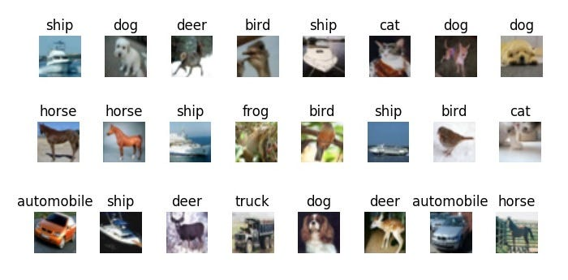

# CIFAR-10 Image Classifier

<p align="center">
  
</p>

A small image-classification project that trains a convolutional neural network (CNN) with PyTorch to recognize the ten object categories in the CIFAR-10 dataset.

## What it does

- Loads CIFAR-10 batches and scales image pixel values to the range 0–1.
- Trains a CNN with two convolutional blocks, batch normalization, max pooling, and fully connected layers.
- Evaluates the model on the test batch after each epoch.
- Plots the average training loss and test loss across epochs.

The network accepts 32 × 32 RGB images and produces predictions for ten classes: airplane, automobile, bird, cat, deer, dog, frog, horse, ship, and truck.

## Project structure

```text
.
├── assets/
│   └── image.png
├── dataset/                # CIFAR-10 batch files (not included in Git)
├── dataset.py              # PyTorch Dataset wrapper and image example
├── main.py                 # Training, evaluation, and loss plot
├── neural_network.py       # SimpleCNN model
└── preprocess_data.py      # CIFAR-10 batch loading and preprocessing
```

## Requirements

- Python 3
- PyTorch
- Matplotlib

Install the required packages:

```bash
python -m pip install torch matplotlib
```

## Dataset setup

Download and extract the **CIFAR-10 Python version** from the [official CIFAR-10 dataset page](https://www.cs.toronto.edu/~kriz/cifar.html). Put the extracted batch files in a `dataset/` directory at the project root. The following files are expected:

```text
dataset/
├── data_batch_1
├── data_batch_2
├── data_batch_3
├── data_batch_4
├── data_batch_5
└── test_batch
```

The dataset files are excluded from Git by `.gitignore`.

## Run

From the project root, start training with:

```bash
python main.py
```

The script trains for five epochs, prints training loss and test accuracy, and displays a plot of training and test loss. Training settings such as the learning rate, mini-batch size, and number of epochs are defined near the top of `main.py`.

## License and dataset

The CIFAR-10 dataset is provided by the University of Toronto. Refer to the [official dataset page](https://www.cs.toronto.edu/~kriz/cifar.html) for dataset details and terms of use.
